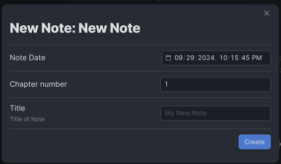
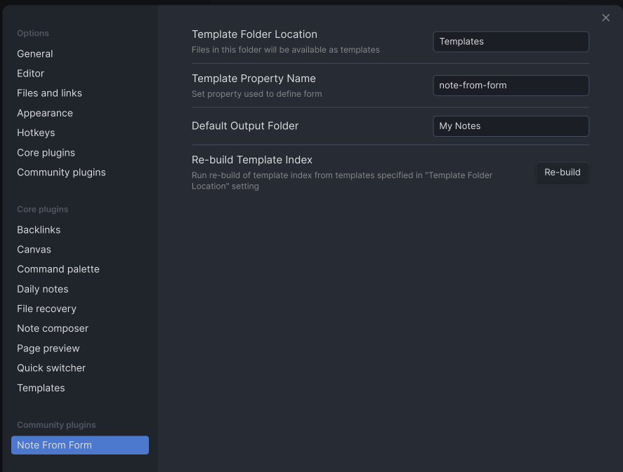
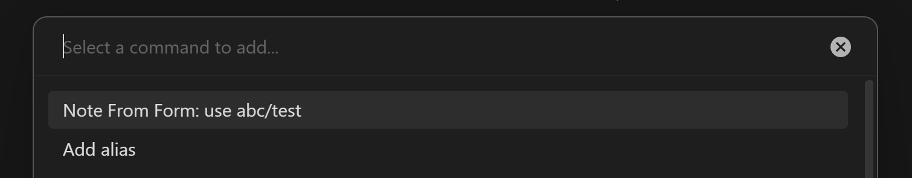
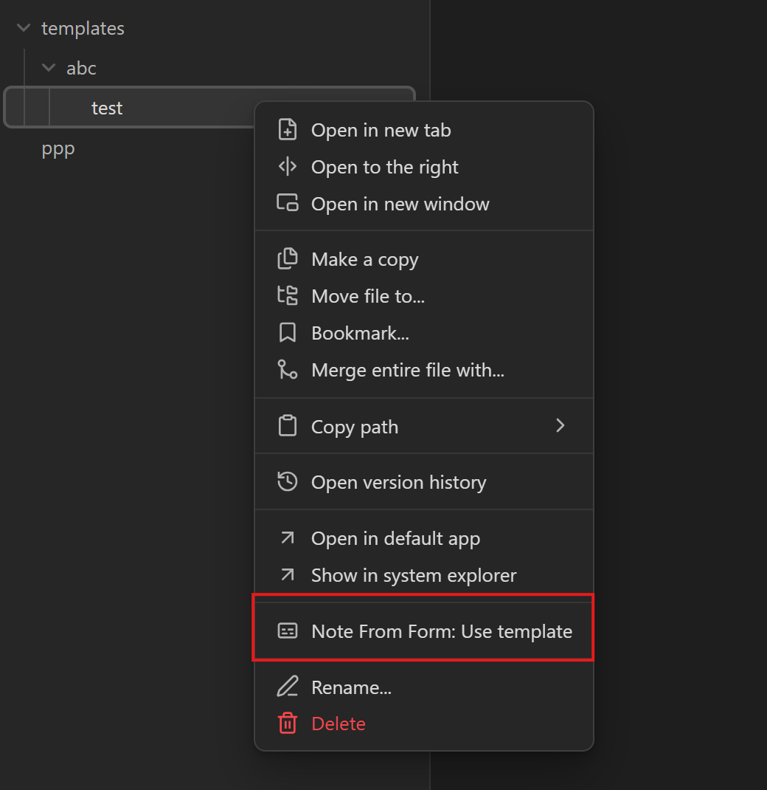

# Note From Form

> **⚠️ Breaking Changes in v2.0**
> Version 2.0 introduces breaking changes that are not backward compatible with previous versions. Templates created for v1.x may need to be updated. Please review the updated documentation below before upgrading.

[Obsidian](https://obsidian.md/) plugin that allows to define form with different type of input fields and JavaScript support that will later be used together with template to generate notes.

It behaves same as Templates Core plugin or [From Template](https://github.com/mo-seph/obsidian-note-from-template) but extends its functionality with strongly typed fields, allows initial values and supports user defined JavaScript functions for value generations. 

> [!TIP]
> Template can be described in both YAML (just [like note properties](https://obsidian.md/help/properties#Property+format) in Obsidian) or JSON.


Consider having template like one of those

<table>
<tr>
<th>YAML</th>
<th>JSON</th>
</tr>
<tr>
<td>

```yaml
---
tags: tag1, tag2
aliases: alias1
date: "{{date}}"
note-from-form:
  file-name: "t:My Note {{noteNum}}"
  file-location: "f:async (view, api) => 'My Folder'"
  form-items:
    - id: date
      type: dateTime
      get: "t:yyyy-MM-DDTHH:mm:ss"
      form:
        title: Note Date
    - id: chapterNum
      type: number
      init: "v:1"
      form:
        title: Chapter number
    - id: title
      type: text
      form:
        title: Title
        description: Title of Note
        placeholder: My New Note
    - id: done
      type: checkbox
      form:
        title: Mark as done
    - id: category
      type: dropdown
      init: 'v:[{"k":"work","v":"Work"},{"k":"personal","v":"Personal"}]'
      form:
        title: Category
    - id: noteNum
      type: number
      get: "f:async (view, api) => moment(view.date).format('x')"
beforeCreate: "f:async (view, api) => { /* hook called right before note creation */ }"
---

# Chapter {{chapterNum}}: {{title}}

Done: {{done}}
Category: {{category}}
```

</td>
<td>

```yaml
---
tags: tag1, tag2
aliases: alias1
date: "{{date}}"
note-from-form: |-
  {
    "file-name": "t:My Note {{noteNum}}",
    "file-location": "f:async (view, api) => 'My Folder'",
    "form-items": [
      {
        "id": "date",
        "type": "dateTime",
        "get": "t:yyyy-MM-DDTHH:mm:ss",
        "form": {
          "title": "Note Date"
        }
      },
      {
        "id": "chapterNum",
        "type": "number",
        "init": "v:1",
        "form": {
          "title": "Chapter number"
        }
      },
      {
        "id": "title",
        "type": "text",
        "form": {
          "title": "Title",
          "description": "Title of Note",
          "placeholder": "My New Note"
        }
      },
      {
        "id": "done",
        "type": "checkbox",
        "form": {
          "title": "Mark as done"
        }
      },
      {
        "id": "category",
        "type": "dropdown",
        "init": "v:[{\"k\":\"work\",\"v\":\"Work\"},{\"k\":\"personal\",\"v\":\"Personal\"}]",
        "form": {
          "title": "Category"
        }
      },
      {
        "id": "noteNum",
        "type": "number",
        "get": "f:async (view, api) => moment(view.date).format('x')"
      }
    ],
    "beforeCreate": "f:async (view, api) => { /* hook called right before note creation */ }"
  }
---

# Chapter {{chapterNum}}: {{title}}

Done: {{done}}
Category: {{category}}
```

</td>
</tr>
</table>

After adding template to the index and call for template, following form will be displayed:



And will generate following Markdown and add it to the note named `My Note 1727640827748` where `1727640827748` is Unix timestamp of `Note Date` field. Note will be created in directory named `My Folder`.

```markdown
---
tags: tag1, tag2
aliases: alias1
date: 2024-09-29T22:13:47

---

# Chapter 1: This is title

Done: false
Category: Work
```

## Using
1. Install plugin
2. Open plugin settings and set location of template files. Also you can specify obsidian property that will point to template definition:

3. Create set of templates that will be used by plugin to generate input form and new notes. See [Template Description](#template-description);


If template files have no issues Obsidian command palette will be enriched with new commands in format `Note From Form: path/to/template`, and context menu option will appear for template file. Use commands from command palette to create new note from template:

| Use template from commands | Use template from context menu |
|-|-|
|  |  |


## Template Description

Form and note template are defined as markdown files that supports [mustache](https://mustache.github.io/) syntax for values that need to be placed from form. Instructions for form itself are defined as [JSON](https://www.json.org/json-en.html) or [YAML](https://yaml.org/) object inside [properties](https://help.obsidian.md/Editing+and+formatting/Properties). Property name might be defined in plugin settings or be a default value `note-from-form`.

Form template contains following fields:
- [`file-name`](#file-name) used to define name of the result file;
- [`file-location`](#file-location) used to define folder where new note will be stored;
- [`form-items`](#form-items) used to define content of the input form or compute values for template based on the input or user-defined logic;
- [`beforeCreate`](#beforecreate) optional hook executed right before note is created.

### `file-name`

Used to specify name of the file for new note.

This property should be initialized with following format `<type>:<value>`. `type` specifies outcome of the value and might be one of the following:
- `v`. In this case content after `:` will be used as result. For example `v:My File`;
- `t`. In this case post-processed input form will be used as source for [mustache](https://mustache.github.io/) template passed after `:`. For example, `t:My Note {{noteNum}}`;
- `f`. In this case user defined async JavaScript function can be specified. Function accepts two parameters: `view` — object constructed from all fields defined in `form-items` after calling `get` function (see below) for each of them — and `api` — instance of [User API](#user-api). This might be used in case if result should be computed based on some complex logic not supported by mustache templates. For example, `f:async (view, api) => 'My Value ' + moment(Date.now()).format()`;
- `ref`. In this case content after `:` is a [reference](#function-references) to a named function. For example, `ref:myFunc` or `ref:/lib/helpers.md:myFunc`.

`file-name` is optional and if not defined, textbox with input for new file name will be displayed on input form.

### `file-location`

Used to specify location of file with new note in Obsidian vault. 

This property should be initialized with following format `<type>:<value>`. `type` specifies outcome of the value and might be one of the following:
- `v`. In this case content after `:` will be used as result. For example `v:/My Folder`;
- `t`. In this case post-processed input form will be used as source for [mustache](https://mustache.github.io/) template passed after `:`. For example, `t:My Note {{noteNum}}`;
- `f`. In this case user defined async JavaScript function can be specified. Function accepts `view` and `api` parameters (see [`get`](#get) for details). For example, `f:async (view, api) => '/My Folder/' + view.category`;
- `ref`. In this case content after `:` is a [reference](#function-references) to a named function. For example, `ref:resolveFolder`.

`file-location` is optional and if not defined value specified in plugin settings would be used. In case if plugin settings are missing it, textbox for input will be displayed on input form.

### `form-items`

Is array of items that are defining structure and content of input form and used as source for generating object that will be later used by plugin as source for **mustache** blocks inside template.

Each item of array may have following structure:

<table>
<tr>
<th>YAML</th>
<th>JSON</th>
</tr>
<tr>
<td>

```yaml
id: field Id
type: field type
init: init function
get: get function
validate: validate function
form:
  title: title of field on form
  placeholder: for text field shows some placeholder
  description: description of the field on form
```

</td>
<td>

```json
{
  "id": "field Id",
  "type": "field type",
  "init": "init function",
  "get": "get function",
  "validate": "validate function",
  "form": {
    "title": "title of field on form",
    "placeholder": "for text field shows some placeholder",
    "description": "description of the field on form"
  }
}
```

</td>
</tr>
</table>

| Field Name | Is Mandatory | Description | Possible values |
|-|-|-|-|
| `id` | yes | Declare identifier of the field in form. By this identifier field can be later referenced inside user defined function or mustache template | string with field name, i.e. `date` |
| `type` | yes | Specify [type of input field](#input-type-fields). Type of the field allow you to control what user can input, what operations can be done and how field would be displayed | `text`, `textArea`, `date`, `time`, `dateTime`, `number`, `checkbox`, `dropdown` |
| `init` | no | [`init`](#init) function. Used to get initial value of field. In case if not specified, default value would be used | Pure values or user defined functions (see below) |
| `get` | no | This is [`get`](#get) function that is called after all input provided and used to create result object that will be used as source of values for template, `file-name` and `file-location` | Pure value, mustache template or user defined function |
| `validate` | no | [`validate`](#validate) function. Called after every `get` to verify the field value. Must return `{ isValid, errMsg }`; when `isValid` is `false`, `errMsg` is shown inline and note creation is aborted | User defined function or [reference](#function-references) |
| `form` | no | Instructs plugin how to render field on form. This property might be skipped if some computed values are needed but shouldn't be changed by user | Complex object that have `title`, `placeholder` and `description` fields |
| `title` | no | Used to provide user-friendly name of the field. | Any string |
| `placeholder` | no | For fields of `text` and `textArea` types might be used as field placeholder. For other types is not used | Any string |
| `description` | no | Used to provide user-friendly description of the field on input form | Any string |

### `get`
`get` function used to get final result of input and generate model used as source for template `mustache` blocks. It might be defined in one of four variants:

- `v:<value>`. This instructs `get` function to return string value defined after `:`. For example, `v:Hello World!` will return `Hello World!` string and assign it to appropriate field in model used in mustache blocks of template;
- `t:<mustache string>`. This instructs `get` function to collect all values defined in [`form-items`](#form-items) and use it as source for mustache template defined in `<mustache string>`. For example, 
`t:Hello {{who}}!` will take field from [`form-items`](#form-items) with `id` `who` and use its value for template. Consider, `who` is set to `world` then result of `t:Hello {{who}}!` would be `Hello world!` string;
- `f:<async JS function text>`. This instructs `get` function to execute async function defined in `<async JS function text>`. Function must receive `view` and `api` parameters. For example, `f:async (view, api) => view.myfield + ' + 1'` or `f:async function(view, api) { return view.myfield + ' + 1'; }`;
- `ref:<funcName>` or `ref:<path>:<funcName>`. References a named function declared elsewhere. See [Function references](#function-references).

Function can be useful to produce values based on user input or values that do not need to be provided by user.

Function accepts two arguments: `view` is JS object with fields defined in [`form-items`](#form-items) with latest values entered by user, and `api` is an instance of [User API](#user-api). Function is expected to return string. Function has following TS declaration:
```ts
async function(view: Record<string, any>, api: IUserApi): Promise<string>;
```


> [!WARNING]
> `f:<async JS function text>` use JavaScript `eval()` call to translate text into executable. Use it carefully!

If not specified, default variant is used that returns string representation of field.

### `init`
`init` function used to set initial values of fields declared in [`form-items`](#form-items). `init` function might be defined in one of three variants:

- `v:<value>`. Instructs `init` function to initialize form field from string specified in `<value>`. Based on [field type](#input-type-fields) appropriate casting will be done;
- `f:<async JS function text>`. Use async JavaScript function defined in `<async JS function text>` to initialize form field. Function must receive single `api` parameter. For example, `f:async (api) => 'default value'` or `f:async function(api) { return 42; }`;
- `ref:<funcName>` or `ref:<path>:<funcName>`. References a named function declared elsewhere. See [Function references](#function-references).

Function accepts single `api` argument that is an instance of [User API](#user-api) and is expected to return value with type equivalent to defined in `type`. Function has following TS declaration:
```ts
async function<TFieldType>(api: IUserApi): Promise<TFieldType>;
```

> [!WARNING]
> `f:<async JS function text>` use JavaScript `eval()` call to translate text into executable. Use it carefully!

If not specified, default value will be used.

### `validate`

`validate` function is an optional per-field hook executed after every [`get`](#get) has populated the `view` model and before the note is created. It allows the form item to enforce custom constraints on the collected values.

> [!NOTE]
> `validate` only runs for fields that are rendered on the form (i.e. items with a `form` block). Items without a form element are skipped.

It can be defined in one of two variants:

- `f:<async JS function text>`. Use async JavaScript function defined in `<async JS function text>`. Function must receive `view` and `api` parameters. For example, `f:async (view, api) => ({ isValid: !!view.title, errMsg: 'Title is required' })`;
- `ref:<funcName>` or `ref:<path>:<funcName>`. References a named function declared elsewhere. See [Function references](#function-references).

The function must return an object with the following shape:

```ts
interface ValidateResult {
    isValid: boolean;
    errMsg?: string;
}
```

- When `isValid` is `true`, the field is considered valid and any previously shown error is cleared.
- When `isValid` is `false`, `errMsg` is displayed inline next to the field on the form, and note creation is aborted.

`view` is the object containing the latest values produced by [`get`](#get) for every item in [`form-items`](#form-items). `api` is an instance of [User API](#user-api).

Function has following TS declaration:
```ts
async function(view: Record<string, any>, api: IUserApi): Promise<ValidateResult>;
```

Form item with `validate` may look like this:

<table>
<tr>
<th>YAML</th>
<th>JSON</th>
</tr>
<tr>
<td>

```yaml
id: title
type: text
validate: "f:async (view, api) => ({ isValid: !!view.title, errMsg: 'Title is required' })"
form:
  title: Title
  description: Title of the note
```

</td>
<td>

```json
{
  "id": "title",
  "type": "text",
  "validate": "f:async (view, api) => ({ isValid: !!view.title, errMsg: 'Title is required' })",
  "form": {
    "title": "Title",
    "description": "Title of the note"
  }
}
```

</td>
</tr>
</table>

> [!WARNING]
> `f:<async JS function text>` use JavaScript `eval()` call to translate text into executable. Use it carefully!

### `beforeCreate`

Top-level optional hook executed once, after every form item has been processed and validated, but **before** the destination note is created. Use it to perform cross-field validation, prepare files / folders, or render auxiliary notes via [User API](#user-api).

It can be defined in one of two variants:

- `f:<async JS function text>`. Async JavaScript function receiving `view` and `api` parameters. For example, `f:async (view, api) => { if (!view.title) api.throwError('Title is required'); }`;
- `ref:<funcName>` or `ref:<path>:<funcName>`. References a named function declared elsewhere. See [Function references](#function-references).

Calling `api.throwError(message)` aborts note creation and shows the message to the user. The hook may also use `api.io` to inspect or create files / folders, or `api.renderTemplate(...)` to render additional notes from other templates.

Function has following TS declaration:
```ts
async function(view: Record<string, any>, api: IUserApi): Promise<void>;
```

> [!WARNING]
> `f:<async JS function text>` use JavaScript `eval()` call to translate text into executable. Use it carefully!

### Function references

Instead of inlining function bodies inside `f:` strings you can reference named functions with the `ref:` prefix. Two forms are supported:

- `ref:<funcName>` — reference a function defined in the **same template file** (e.g. inside a code block declaring it). For example, `ref:resolveTitle`.
- `ref:<path>:<funcName>` — reference a function defined in an **external markdown file** stored in the vault. The path must be absolute (starting with `/`). For example, `ref:/lib/helpers.md:resolveTitle`.

Function names must be valid JavaScript identifiers (`[a-zA-Z_$][a-zA-Z0-9_$]*`). The referenced function must follow the same signature as the function slot it is used in (i.e. an `init` ref takes `(api)`, a `get` / `validate` / `beforeCreate` ref takes `(view, api)`).

Using `ref:` is the recommended way to share logic across templates and to keep template front matter short and readable.

### User API

Every `f:` or `ref:` function receives a `api` argument that exposes the plugin's user-facing API. It has the following TS interface:

```ts
interface IUserApi {
    readonly io: InputOutput;
    throwError(message: string): void;
    renderTemplate(template: TFile, viewModel: Record<string, string>): Promise<void>;
}

interface InputOutput {
    readonly templatesDirectory: TFolder;
    readonly defaultOutputDirectory: TFolder;

    createDirectory(path: string): Promise<TFolder>;
    createFile(path: string, content: string): Promise<TFile>;

    getDirectory(path: string): TFolder | null;
    getFile(path: string): TFile | null;

    isDirectory(folder: TAbstractFile): boolean;
    isFile(file: TAbstractFile): boolean;
}
```

- `api.throwError(message)` — aborts the current operation and surfaces `message` to the user. Used by [`beforeCreate`](#beforecreate) to report errors. (Note: [`validate`](#validate) reports errors by returning `{ isValid: false, errMsg }` instead.)
- `api.renderTemplate(template, viewModel)` — renders another template file with the supplied view model. Useful for generating companion notes from within `beforeCreate`.
- `api.io` — vault input/output helpers:
  - `templatesDirectory` / `defaultOutputDirectory` — configured folders from plugin settings;
  - `createDirectory(path)` / `createFile(path, content)` — create new folders / files inside the vault;
  - `getDirectory(path)` / `getFile(path)` — look up existing folders / files (returns `null` if missing);
  - `isDirectory(item)` / `isFile(item)` — type guards over `TAbstractFile`.

#### Obsidian file types

The vault helpers in `api.io` operate on file system entities defined by Obsidian itself. The plugin re-exports them through `IUserApi` without wrapping, so functions inside templates can use the full Obsidian API on the returned objects.

- [`TAbstractFile`](https://docs.obsidian.md/Reference/TypeScript+API/TAbstractFile) — abstract base class for anything stored in the vault. Common members:
  - `name: string` — file or folder name (including extension);
  - `path: string` — full vault-relative path;
  - `parent: TFolder | null` — containing folder;
  - `vault: Vault` — reference to the owning vault.
- [`TFolder`](https://docs.obsidian.md/Reference/TypeScript+API/TFolder) — a folder in the vault (extends `TAbstractFile`). Additionally exposes:
  - `children: TAbstractFile[]` — direct contents of the folder;
  - `isRoot(): boolean` — whether this folder is the vault root.
- [`TFile`](https://docs.obsidian.md/Reference/TypeScript+API/TFile) — a file in the vault (extends `TAbstractFile`). Additionally exposes:
  - `basename: string` — file name without extension;
  - `extension: string` — file extension (without the leading dot);
  - `stat: FileStats` — timestamps and size (`ctime`, `mtime`, `size`).

Use `api.io.isDirectory(item)` / `api.io.isFile(item)` as type guards when you have a generic `TAbstractFile` and need to narrow it to `TFolder` or `TFile`. For full type definitions and additional members, follow the links to the official Obsidian developer documentation.


### Input type fields

Following field types are supported:

- `text`
- `textArea`
- `number`
- `date`
- `time`
- `dateTime`
- `checkbox`
- `dropdown`

#### `text` and `textArea`

Simple single line text input field.

Form item definition may look like this:

<table>
<tr>
<th>YAML</th>
<th>JSON</th>
</tr>
<tr>
<td>

```yaml
id: title
type: text
init: "v:My default title"
form:
  title: Title
  description: Title of the note
  placeholder: Type something…
```

</td>
<td>

```json
{
  "id": "title",
  "type": "text",
  "init": "v:My default title",
  "form": {
    "title": "Title",
    "description": "Title of the note",
    "placeholder": "Type something…"
  }
}
```

</td>
</tr>
</table>

If [`init`](#init) is not set, than empty string used as default value;

If [`get`](#get) is not set, latest user input will be returned.

For this type of field user can specify `placeholder` inside `form` field of [`form-items`](#form-items) item.

In model passed as argument to [`get`](#get) field type would be `string`.


`textArea` is same to `text` but provides multiline.

#### `number`

Generates field for numeric input.

Form item definition may look like this:

<table>
<tr>
<th>YAML</th>
<th>JSON</th>
</tr>
<tr>
<td>

```yaml
id: chapterNum
type: number
init: "v:1"
form:
  title: Chapter number
  description: Sequential chapter index
```

</td>
<td>

```json
{
  "id": "chapterNum",
  "type": "number",
  "init": "v:1",
  "form": {
    "title": "Chapter number",
    "description": "Sequential chapter index"
  }
}
```

</td>
</tr>
</table>

If [`init`](#init) is not set, than `0` used as default value;

If [`get`](#get) is not set, latest user input will be returned.

In model passed as argument to [`get`](#get) field type would be `number`.

#### `date`, `time` and `dateTime`

Generates widget for user input of **date**, **time** or **date & time**.

Form item definition may look like this:

<table>
<tr>
<th>YAML</th>
<th>JSON</th>
</tr>
<tr>
<td>

```yaml
id: noteDate
type: dateTime
get: "t:yyyy-MM-DDTHH:mm:ss"
form:
  title: Note Date
  description: When the note was created
```

</td>
<td>

```json
{
  "id": "noteDate",
  "type": "dateTime",
  "get": "t:yyyy-MM-DDTHH:mm:ss",
  "form": {
    "title": "Note Date",
    "description": "When the note was created"
  }
}
```

</td>
</tr>
</table>

If [`init`](#init) is not set, current date & time will be used as initial value.

If [`get`](#get) is not set, latest user input will be returned and formatted to string using [moment.js](https://momentjs.com/). Based on the type different formatting will be used (see [moment.js|Format](https://momentjs.com/docs/#/displaying/format/))

- `date` - `L` format will be used;
- `time` - `LTS` format will be used;
- `dateTime` - will format time based on system locale.

[moment.js](https://momentjs.com/) can be used inside [`get`](#get) or [`init`](#init) functions to manipulate date and time values.

This type extends `t:` definition of [`get`](#get). Instead of mustache template [moment.js|Format](https://momentjs.com/docs/#/displaying/format/) string can be specified, i.e. `t:YYYY-MM-DDTHH:mm:ss`.

In model passed as argument to [`get`](#get) field type would be `Date`.

#### `checkbox`

Generate widget with switcher to select between `true` and `false`;

Form item definition may look like this:

<table>
<tr>
<th>YAML</th>
<th>JSON</th>
</tr>
<tr>
<td>

```yaml
id: done
type: checkbox
init: "v:false"
form:
  title: Mark as done
  description: Whether the task is completed
```

</td>
<td>

```json
{
  "id": "done",
  "type": "checkbox",
  "init": "v:false",
  "form": {
    "title": "Mark as done",
    "description": "Whether the task is completed"
  }
}
```

</td>
</tr>
</table>

If [`init`](#init) is not set, `false` will be used as initial value.

If [`get`](#get) is not set, latest user input will be returned.

In model passed as argument to [`get`](#get) field type would be `boolean`.

#### `dropdown`

Generates widget with options where one may be selected.

Form item definition may look like this:

<table>
<tr>
<th>YAML</th>
<th>JSON</th>
</tr>
<tr>
<td>

```yaml
id: dropdown
type: dropdown
init: 'v:[{"k":"a","v":"My A"},{"k":"b","v":"My B"},{"k":"c","s":true,"v":"My C"}]'
form:
  title: DropDown
  description: My DropDown
```

</td>
<td>

```json
{
  "id": "dropdown",
  "type": "dropdown",
  "init": "v:[{\"k\":\"a\",\"v\":\"My A\"},{\"k\":\"b\",\"v\":\"My B\"},{\"k\":\"c\",\"s\":true,\"v\":\"My C\"}]",
  "form": {
    "title": "DropDown",
    "description": "My DropDown"
  }
}
```

</td>
</tr>
</table>

[`init`](#init) must be set for this type. As value it expects array of objects. Object should be following:

```ts
{
	"k": "key", 
	"v": "value",
	"s": true // optional
}
```

The `s` flag marks an option as initially selected. If multiple options are marked with `s: true`, the last one wins. If no option is marked, the first option in the array is used.

After initialization the dropdown's stored value is reduced to a single-element array containing only the currently selected option (with the `s` flag stripped). For example, an `init` value of `v:[{"k":"a","v":"Alpha"},{"k":"b","v":"Beta","s":true}]` produces an internal value of `[{ "k": "b", "v": "Beta" }]`. Changing the selection in the UI updates this single-element value accordingly.

If [`get`](#get) is not set, latest `v` of selected object will be returned. 

In model passed as argument to [`get`](#get) field type would be array of 1 element with object that have `k` and `v` fields.
